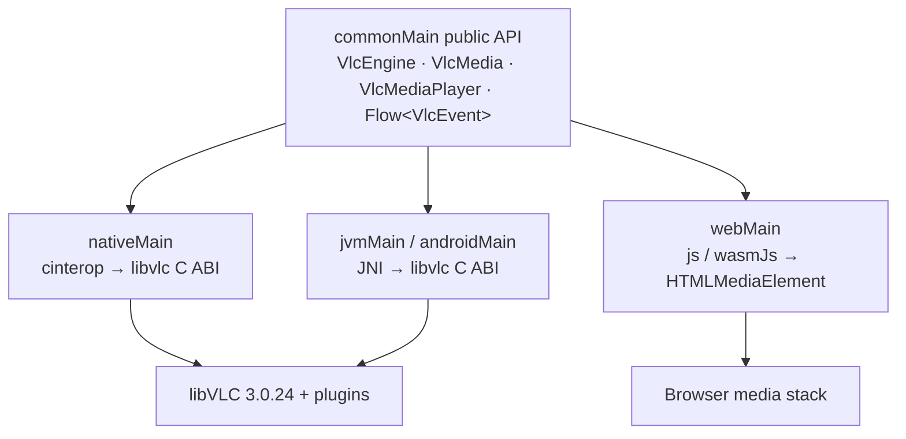

# vlc-kmp

Kotlin Multiplatform bindings for **libVLC 3.0.24**, with one public API across
desktop, Android and the browser.

The repository pins VLC at commit
`6de05adcbaf2e8b85fe86aad4169393098628119` (VLC 3.0.24) through the `vlc`
git submodule. Native/JVM bindings use the libVLC C ABI; `js` and `wasmJs`
implement the same playback surface on `HTMLMediaElement`.

## Platform matrix

| Platform | Kotlin target | Binding | Artifact |
| --- | --- | --- | --- |
| macOS Apple Silicon | `macosArm64` | cinterop | klib |
| macOS Intel | `macosX64` | cinterop | klib |
| Linux x86_64 | `linuxX64` | cinterop | klib |
| Linux ARM64 | `linuxArm64` | cinterop | klib |
| Windows x86_64 | `mingwX64` | cinterop | klib |
| Desktop JVM | `jvm` | JNI bridge | jar + per-host JNI jar |
| Android JVM | `android` | JNI bridge | AAR (4 ABIs) |
| Android ARM64 | `androidNativeArm64` | cinterop | klib |
| Android ARMv7 | `androidNativeArm32` | cinterop | klib |
| Android x86_64 | `androidNativeX64` | cinterop | klib |
| Android x86 | `androidNativeX86` | cinterop | klib |
| Browser JS | `js` | HTMLMediaElement | klib |
| Browser Wasm | `wasmJs` | HTMLMediaElement | klib + npm package |



## Repository layout

- `vlc/` — pinned VLC source submodule; only `include/vlc` is consumed by cinterop.
- `vlc-kmp/` — the multiplatform library.
- `jni/vlc_jni.cpp` — libVLC JNI bridge, loaded by desktop and Android JVM.
- `jni/jvm/<classifier>/` — per-host JNI artifacts published to Maven Central.
- `jni/android-jvm/` — Android AAR packaging `libvlc_jni.so` for four ABIs.
- `examples/player/` — SDL3 + Dear ImGui player for JVM, native, Android and wasm.
- `.github/workflows/` — build/test and publish pipelines.

## Versioning

Published artifacts use `<kmp-version>-fixed.<upstream-version>`, for example
`1.0.0-fixed.3.0.24`: `1.0.0` is this KMP module's version and `3.0.24` is the
pinned libVLC release.

## Using the library

### Common API

```kotlin
val engine = Vlc.create(listOf("--no-video-title-show"))
val media = engine.createMedia("/path/to/movie.mp4")
val player = engine.createMediaPlayer()

player.media = media
player.setVideoSink { frame ->
    // frame.pixels is RV32, reused by libVLC; the negotiated frame size is
    // frame.width x frame.height. Copy the pixels if they are retained.
    renderer.upload(frame.pixels, frame.pitch)
}
player.play()

// Events are buffered by a shared flow; collection is not required for playback.
player.events.collect { event ->
    when (event) {
        is VlcEvent.PlayerTimeChanged -> println(event.time)
        is VlcEvent.PlayerEndReached -> println("done")
        else -> Unit
    }
}

player.close()
media.close()
engine.close()
```

`VlcCapabilities` distinguishes native libVLC from the browser backend:
`nativeLibVlc`, `softwareVideoCallbacks`, `snapshot`, `rendererDiscovery`,
`protocols`, etc. The browser backend reports the actual subset it implements
rather than silently accepting unsupported calls.

### Desktop runtime

The Kotlin artifacts do not bundle libVLC on desktop. Install VLC with the
platform package manager and make sure the shared library is discoverable:

- macOS: `/Applications/VLC.app/Contents/MacOS/lib/libvlc.dylib` is found
  automatically, including the bundled plugin path.
- Linux: install `libvlc-dev` (or the libVLC runtime package); the JNI bridge
  tries `libvlc.so.5` and `libvlc.so`.
- Windows: install VLC under `C:\Program Files\VideoLAN\VLC`, or set
  `VLC_LIBRARY_DIR`.

Override the search with:

```bash
export VLC_LIBRARY_PATH=/path/to/lib/libvlc.so
export VLC_PLUGIN_PATH=/path/to/vlc/plugins   # optional
```

The JNI bridge `dlopen`s libVLC at runtime, so a missing runtime produces a
single `UnsatisfiedLinkError` naming the attempted paths.

### Android

```kotlin
implementation("cn.enaium.vlc:vlc-kmp:1.0.0-fixed.3.0.24")
```

The Android variant depends on `org.videolan.android:libvlc-all`, which ships
`libvlc.so` and plugins for `arm64-v8a`, `armeabi-v7a`, `x86_64` and `x86`.
The bridge itself is packaged as `libvlc_jni.so` for the same four ABIs. A
locally built runtime can be bundled instead with `VLC_ANDROID_LIBS_DIR`
(layout: `<abi>/libvlc.so`).

For `androidNative*` targets the klib binds the 3.0.24 headers. Applications
must provide `libvlc.so` at link time and runtime, exactly as for any other
native library.

### Browser

`js` and `wasmJs` expose the same interfaces. `Vlc.create()` creates a hidden
`<video>`; `VlcWeb.create(video)` uses an existing element:

```kotlin
val engine = VlcWeb.create(document.getElementById("video") as HTMLVideoElement)
val player = engine.createMediaPlayer()
player.media = engine.createMedia("movie.mp4")
player.play()
```

This is a browser media backend, not a libVLC-for-Wasm port. It supports the
protocol and codec set of the browser; libVLC-only filters, renderers,
snapshots and software frame callbacks return `false` from
`VlcCapabilities.nativeLibVlc == false`.

The wasm artifact is published as `@enaium/vlc-kmp` and exports a small
JavaScript facade (`createEngine`, `createMedia`, `createPlayer`, `load`,
`play`, `pause`, `seek`, `closePlayer`, ...).

## Examples

The example is a compact player with a video area, load field, play/pause,
stop, mute, volume, seek bar, time display and keyboard shortcuts.

### JVM

```bash
./gradlew :examples:player:jvmRun
./gradlew :examples:player:jvmRun --args="--file /path/to/movie.mp4"
SDL_VIDEO_DRIVER=dummy ./gradlew :examples:player:jvmRun --args="--no-audio --frames 300"
```

### Kotlin/Native

```bash
./gradlew :examples:player:linkDebugExecutableMacosArm64
SDL_VIDEO_DRIVER=dummy VLC_KMP_FRAMES=120 VLC_KMP_NO_AUDIO=1 \
  VLC_KMP_FILE="$PWD/examples/player/src/commonMain/resources/sample.mp4" \
  ./examples/player/build/bin/macosArm64/debugExecutable/player.kexe
```

The host libVLC prefix is auto-detected (`/Applications/VLC.app/...` on macOS,
multiarch paths on Linux) and added as link search path/rpath. Override with
`-Pvlc.library.dir=/path/to/lib` or `VLC_LIBRARY_DIR`.

### Android

```bash
./gradlew :examples:player:android:assembleDebug
adb install examples/player/android/build/outputs/apk/debug/android-debug.apk
```

The APK contains SDL, ImGui, the JNI bridge, libVLC and plugins for four ABIs.

### Browser

```bash
./gradlew :examples:player:copyWebAssets
python3 -m http.server -d examples/player/build/browserApp 8080
```

Open `http://localhost:8080`. The page loads the bundled `sample.mp4`; the
canvas is SDL/ImGui and the `<video>` element is positioned underneath by Kotlin.

## Building from source

```bash
git submodule update --init --recursive
./gradlew build
```

Requirements:

- JDK 21
- Kotlin/Native toolchain downloaded by Gradle
- Android SDK with NDK 27+ and `compileSdk 37` for the example (library targets use 36)
- CMake 3.16+ and a C++17 compiler for the JNI bridge
- libVLC, or VLC.app/installed VLC, for native tests and examples

Useful checks:

```bash
./gradlew :vlc-kmp:jvmTest
./gradlew :vlc-kmp:compileKotlinMacosArm64
./gradlew :vlc-kmp:compileKotlinLinuxX64 :vlc-kmp:compileKotlinLinuxArm64
./gradlew :vlc-kmp:compileKotlinMingwX64
./gradlew :vlc-kmp:compileKotlinAndroidNativeArm64
./gradlew :vlc-kmp:compileKotlinJs :vlc-kmp:compileKotlinWasmJs
./gradlew :android-jvm:assembleRelease
```

## Licensing

The Kotlin bindings and JNI bridge are licensed under **GPL-2.0-or-later**
(see `LICENSE`). You must also comply with libVLC's own LGPL-2.1+ license,
the licenses of the VLC plugins you distribute, and the licenses of any
third-party codecs. `org.videolan.android:libvlc-all` and bundled VLC plugins
may contain GPL components; do not assume the whole VLC distribution is LGPL.
The `vlc` submodule is VLC's own source tree and retains its upstream license.
